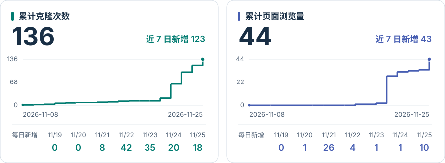

# 仓库访问与克隆统计

<!-- traffic:start -->

首次扩展采集完成后，此处显示最近 14 天的访问、克隆与热门页面。

<!-- traffic:end -->

## 累计克隆趋势

曲线累计已归档的完整 UTC 日。上方概览直接采用 GitHub 滚动窗口的总数，包含当日已上报的活动。查看[每日克隆与独立克隆者](daily.csv)和[每日浏览与独立访客](views.csv)。跨天去重采用 GitHub 返回的整个窗口统计，同一个人可以在多个日期出现。

任务每天北京时间 13:37 定时运行，合并 GitHub 近 14 天窗口中最近 13 个完整 UTC 日的数据。同一天重复采集时更新该行。超出窗口且没有采集过的日期会在曲线上留空。归档通过 API 更新，采集过程本身无需 clone 仓库。

## 启用

1. 在 GitHub 创建仅授权本仓库的 fine-grained personal access token，设置仓库权限 **Administration → Read-only**。
2. 打开仓库 **Settings → Secrets and variables → Actions**，将令牌存为 repository secret `TRAFFIC_TOKEN`。
3. 在 **Actions → Archive clone history → Run workflow** 选择默认分支，运行首次采集。任务用 GitHub Actions 自带的令牌提交 CSV 和曲线，需要允许该工作流写入默认分支。

数据来源见 [GitHub Traffic API](https://docs.github.com/en/rest/metrics/traffic#get-repository-clones)。
